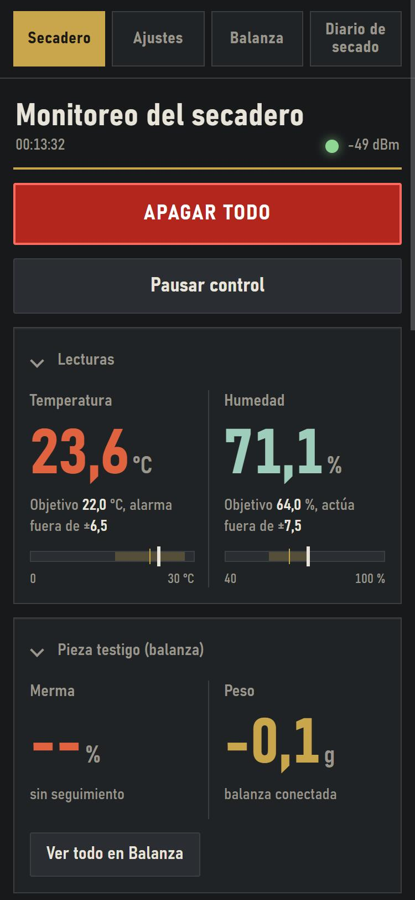
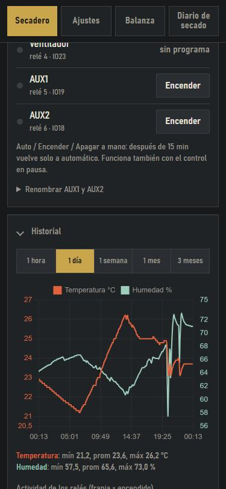

# Cámara de curado

### Estuve buscando AÑOS un controlador para secado de charcuteria.
### Con una placa de las más baratas del mercado se puede hacer, y ademas lo manejas desde el celu.

  
  &nbsp;&nbsp;
  

Soy aficionado a la charcutería. Curar en casa es cuestión de paciencia y de clima: temperatura baja y estable, humedad alta
pero controlada, aire que se renueva. Una heladera familiar sola enfría de más y reseca todo, y yo no encontraba nada que me
sirviera, así que armé esto.

Le pone un **cerebro** a la heladera: elegís cuánta temperatura y cuánta humedad querés, y la cámara las sostiene sola,
semanas y semanas, mientras vos mirás cómo va el salame desde el sillón.

Lo comparto **gratis y con el código abierto (licencia MIT)** por si a otros aficionados les sirve: bajalo, armalo, cambiale lo
que quieras. No lo vendo ni lo voy a vender. Si lo armás, contame cómo te fue (abrí un *Issue*).

## Qué controla

| | |
|---|---|
| **Temperatura** | Prende y apaga el compresor de la heladera para mantener la que elijas. |
| **Humedad** | Con **humidificador** y **deshumidificador** (nunca los dos a la vez). |
| **Ventilación** | Renueva el aire con un programa: *cada tantas horas, tantos minutos*. |
| **2 salidas auxiliares** | Una luz, un extractor, lo que se te ocurra. Les ponés el nombre que quieras. |

Todo con una **ESP32**, esa placa chiquita y baratísima con Wi-Fi.

## ¿Qué heladera sirve?

Una heladera común **a motor de compresión**, de las de toda la vida. **Las minineveras Peltier no sirven**: el programa
está pensado para los ciclos de un compresor y para protegerlo.

> **Ojo, esto maneja 220 V.** Si no sabés trabajar con electricidad, pedile ayuda a alguien que sí. Un botón en la
> pantalla no reemplaza una llave térmica ni desenchufar. Usalo bajo tu responsabilidad.

## Lo que necesitás comprar

- Una placa **ESP32** (formato Uno, "ESP32 Dev Module", 4 MB de flash)
- Un sensor **DHT22** de temperatura y humedad
- Un **módulo de 6 relés** de 5 V
- Una **pantalla LCD 20x4 con módulo I2C**
- Un **encoder rotativo con pulsador** (KY-040)
- Una **fuente de 5 V** (2 A o más)
- Cables, borneras, una caja y un cable de 220 V con ficha. Y una llave térmica o fusible en la entrada.

Para la **balanza** (opcional): una ESP32, una celda de carga de 1 kg tipo barra, un módulo HX711 y una fuente de 5 V.

<b>Cómo montarlo: conexiones, 220 V y cuidados</b>

### 1. Conexiones de la cámara

Todo con la **fuente desconectada**. Alimentá la placa y el módulo de relés con 5 V.

| Componente | Pin del módulo | Se conecta a (ESP32) |
|---|---|---|
| **Relés** | IN1 (frío) | GPIO 26 |
| | IN2 (humidificador) | GPIO 25 |
| | IN3 (deshumidificador) | GPIO 13 |
| | IN4 (ventilador) | GPIO 23 |
| | IN5 (AUX1) | GPIO 19 |
| | IN6 (AUX2) | GPIO 18 |
| | VCC / GND | 5 V / GND |
| **DHT22** | DATA | GPIO 27 |
| | VCC / GND | **3V3** / GND |
| **LCD I2C** | SDA / SCL | GPIO 21 / GPIO 22 |
| | VCC / GND | 5 V / GND |
| **Encoder KY-040** | CLK / DT / SW | GPIO 34 / GPIO 35 / GPIO 4 |
| | "+" / GND | **3V3** (nunca 5 V) / GND |

Los módulos de relés comunes se activan con el pin en **bajo**; ya está configurado así (`RELE_ACTIVO_BAJO 1`).
Si el tuyo es al revés, cambialo en `config.h`. Con otra placa, los pines se cambian en `hardware.h` y `config.h`.

### 2. Los equipos de 220 V

- Cada equipo va al **contacto normal abierto (NO)** de su relé, en serie con la fase. El neutro y la tierra van directos.
- El relé 1 maneja el **compresor** de la heladera. Los motores son cargas inductivas: usá relés de buena capacidad o, mejor,
  un **contactor** comandado por el relé.
- El compresor tiene un **tiempo mínimo de apagado** de 3 minutos que el programa respeta solo.
- El termostato propio de la heladera tiene que quedar **anulado o en el punto más frío**, para que no interfiera.
- Dejá el sensor DHT22 **dentro de la cámara**, lejos del humidificador y de la salida de aire frío.

### 3. La balanza

| HX711 | Se conecta a (ESP32) |
|---|---|
| VCC | **3V3** |
| GND | GND |
| DT | GPIO 19 |
| SCK | GPIO 18 |

La celda de carga va a los pines E+, E−, A+, A− del módulo (los colores de los cables cambian según el fabricante).
Colgá la pieza de la barra con un gancho; la celda se monta fija por un extremo.

### Cuidado con el pin "GND" junto al 5 V

En algunas placas ESP32 **la serigrafía está mal**: el pin rotulado "GND" que está junto al de 5 V **no es masa** (es el
GPIO 11, que usa la memoria flash). Si conectás un cable ahí, la placa puede no arrancar, reiniciarse en bucle
(`flash read err`) o los relés no hacer clic. Usá siempre el **otro** pin GND, el que tiene continuidad con la carcasa del
conector USB. Y no inviertas VCC y GND del HX711: se calienta en segundos y se puede quemar.

<b>Cómo cargarle el programa</b>

1. Instalá **Arduino IDE** o **arduino-cli** con el soporte de **ESP32 (core 3.x)** y las librerías: DHT (Adafruit),
   ESPAsyncWebServer + AsyncTCP (ESP32Async), ArduinoJson 7 y hd44780.
2. Placa **ESP32 Dev Module**, esquema de partición **Custom** (usa el `partitions.csv` de esta carpeta: deja lugar para la
   actualización por Wi-Fi).
3. Primera carga por USB: `node subir.mjs COM3` (cambiá el puerto). Después se actualiza por Wi-Fi con `node subir.mjs`, o
   desde la web en *Ajustes > Diagnóstico > Actualizar el programa por Wi-Fi*.
4. La primera vez la placa crea una red Wi-Fi llamada **CamaraCurado-Setup**: conectate con el celular, abrí
   `192.168.4.1/wifi` y elegí tu red. El Wi-Fi no va escrito en el código.

<b>Cómo se usa</b>

- **Web**: abrí `http://camara-curado.local` o la IP que muestra el menú del equipo (*Diagnóstico > Red e IP*). Pestañas:
  **Secadero** (estado y botones), **Ajustes**, **Balanza** y **Diario de secado**. Arriba está el botón rojo **APAGAR TODO**.
- **Menú del equipo**: apretá la perilla en la pantalla normal. Todo el menú está en [`docs/Menu_LCD.pdf`](docs/Menu_LCD.pdf).
- **Calibración del sensor**: hay un asistente (con sal) en el menú y en la web.

---

## In English

**I'm a home charcuterie hobbyist and I built this to cure my own salami. I'm sharing it, free and open source, in case it helps other hobbyists.**
It turns an ordinary **compressor refrigerator** into a dry-aging chamber using a cheap **ESP32**. It controls **temperature**
(compressor), **humidity** (humidifier + dehumidifier), a **programmable fan** and **two auxiliary outputs**, and you run it from
your phone through its own web page (no cloud, no app, no internet). It also keeps history charts and a drying diary, works with
an optional wireless scale to follow the weight loss of a control piece, protects the compressor, has an emergency stop button
and updates over Wi-Fi. **Compressor fridges only; Peltier coolers are not supported.** The device interface is in Spanish.
**It switches mains voltage: build it only if you know how to do it safely, at your own risk.**

## Licencia

MIT (ver [`LICENSE`](LICENSE)). El software se entrega "tal cual", sin garantía de ningún tipo: el autor no se hace
responsable por daños a equipos, alimentos o personas.
